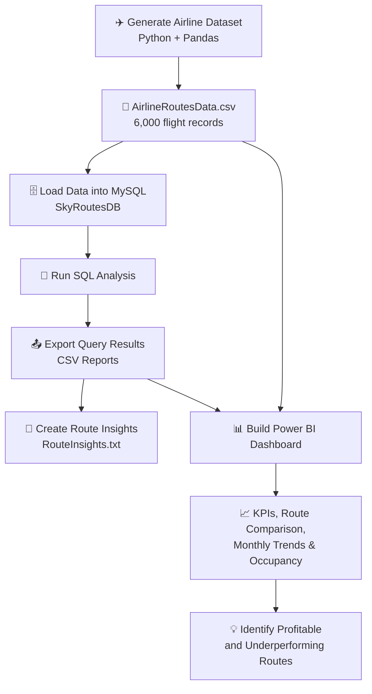

<div align="center">

# ✈️ SkyRoutes Profit Lab
### Identifying Profitable Airline Routes

**A data analytics project using Python, SQL, and Power BI**

📊 Route Profitability • 💰 Revenue & Cost Analysis • 🪑 Seat Occupancy • 📈 Monthly Trends

</div>

---

## 📌 Project Overview

**SkyRoutes Profit Lab** explores airline flight data to understand which routes and aircraft perform well financially, which routes are underperforming, and how revenue, operating costs, and seat occupancy change over time.

The workflow combines Python-based dataset preparation, MySQL analysis, exported CSV results, and a Power BI dashboard.

> **Dataset note:** The project dataset is generated for analysis and demonstration. Findings describe this dataset and should not be interpreted as real-world airline performance.

## 🎯 Project Objectives

- Identify frequently operated routes.
- Compare route-level revenue, operating cost, and profit.
- Find routes with negative average profit.
- Measure seat occupancy by route.
- Compare domestic and international route performance.
- Rank routes by revenue per flight minute.
- Compare profitability across aircraft types.
- Review monthly profitability trends.

## 🧰 Tools & Technologies

| Tool | How it is used |
|---|---|
| 🐍 Python | Generate, prepare, and analyze flight data |
| 🐼 Pandas | Data handling and CSV input/output |
| 🗄️ MySQL | Store flight records and run analytical SQL queries |
| 📊 Power BI | Build interactive dashboard visuals |
| 📁 CSV | Store the source dataset and query outputs |
| 🧮 DAX | Calculate dashboard KPIs and measures |

## 🔄 Project Workflow



## 🖼️ Power BI Dashboard Preview

The screenshot below is stored in this repository at `screenshots/powerbi-dashboard.png`. Keep the `screenshots` folder beside this `README.md` file so GitHub can display the image.


## 📊 Analysis & Deliverables

The analysis exports these result files:

| File | Purpose |
|---|---|
| `01_Top10FrequentRoutes.csv` | Ten routes with the highest flight counts |
| `02_RouteProfitability.csv` | Revenue, cost, average profit, and total profit by route |
| `03_UnderperformingRoutes.csv` | Routes with negative average profit |
| `04_SeatOccupancy.csv` | Seats sold, available seats, and occupancy by route |
| `05_MonthlyProfitByRoute.csv` | Monthly profitability grouped by route |
| `06_DomesticVsInternational.csv` | Domestic vs. international performance |
| `07_RevenuePerMinuteRank.csv` | Routes ranked by revenue per flight minute |
| `08_AircraftProfitability.csv` | Profitability and occupancy by aircraft type |
| `09_MonthlyOverallProfit.csv` | Overall monthly revenue, cost, and profit |
| `RouteInsights.txt` | A concise summary of key findings |

## 🔍 Example Insights from the Generated Dataset

The current generated analysis reports:

- 🏆 **Highest average-profit route:** `BOM-DOH`, with average profit of **4,098,878.35** per flight.
- ⚠️ **Lowest average-profit route:** `CCU-DEL`, with average profit of **-565,288.51** per flight.
- 🛫 **Highest average-profit aircraft:** `Airbus A321`, at **1,971,439.61** per flight.
- 🪑 **Weighted seat occupancy:** **75.96%**.
- 🌍 **International routes** contribute more total profit than domestic routes in this generated dataset.

These values come from the supplied `RouteInsights.txt` output and reflect the project's generated data, not real airline financial statements.

## 📁 Suggested Repository Structure

```text
Identifying-Profitable-Airline-Routes/
├── README.md
├── generate_data.py
├── run_analysis.py
├── quieres.sql
├── data/
│   └── AirlineRoutesData.csv
├── outputs/
│   ├── 01_Top10FrequentRoutes.csv
│   ├── 02_RouteProfitability.csv
│   ├── 03_UnderperformingRoutes.csv
│   ├── 04_SeatOccupancy.csv
│   ├── 05_MonthlyProfitByRoute.csv
│   ├── 06_DomesticVsInternational.csv
│   ├── 07_RevenuePerMinuteRank.csv
│   ├── 08_AircraftProfitability.csv
│   └── 09_MonthlyOverallProfit.csv
├── RouteInsights.txt
├── RouteProfitDashboard.pbix
└── screenshots/
    └── powerbi-dashboard.png
```

> Filenames in your local project may differ slightly. Adjust the names in this structure to match the files you upload.

## 🚀 How to Run

### 1. Install dependencies

```bash
python -m pip install pandas numpy mysql-connector-python
```

### 2. Generate the dataset

Run from the project root:

```bash
python generate_data.py
```

This creates `data/AirlineRoutesData.csv` with 6,000 generated flight records.

### 3. Configure MySQL

Open `run_analysis.py` and update the connection settings to match your local MySQL setup:

```python
DB_HOST = "localhost"
DB_USER = "root"
DB_PASSWORD = "YOUR_MYSQL_PASSWORD"
DB_NAME = "SkyRoutesDB"
```

**Security tip:** Do not commit real passwords or credentials to a public GitHub repository.

### 4. Run the analysis

```bash
python run_analysis.py
```

The script creates the database/table, imports the CSV, runs SQL analyses, exports the CSV result files, and generates `RouteInsights.txt`.

### 5. Open the Power BI report

Open `RouteProfitDashboard.pbix` (or your actual `.pbix` filename), confirm the data source is connected correctly, and refresh the report if needed.

## 📈 Dashboard Ideas

For a recruiter-friendly report, include:

- 💰 KPI cards for Total Revenue, Total Operating Cost, and Total Profit
- 🏆 Top 10 profitable routes
- 📉 Monthly profit trend
- 🪑 Seat occupancy gauge
- ⚖️ Revenue vs. operating cost by route
- 🎛️ Slicers for aircraft type, month, and route

Only describe visuals as completed if they are present in your final `.pbix` report.

## 💡 Business Value

This project demonstrates how analytics can support airline planning by helping stakeholders:

- Compare route-level financial performance.
- Detect loss-making routes that may need investigation.
- Monitor seat utilization.
- Compare aircraft profitability.
- Track changes in performance over time.

## 👩‍💻 Skills Demonstrated

`Python` · `Pandas` · `SQL` · `MySQL` · `Power BI` · `DAX` · `Data Analysis` · `Data Visualization` · `Business Insights`

## 🔮 Future Improvements

- Connect to validated operational data.
- Add airport coordinates and route mapping.
- Include forecasting for demand and profitability.
- Add sensitivity analysis for fuel costs and ticket pricing.
- Improve data validation and automate report refreshes.

## 🙌 Acknowledgements

Created as an airline route analytics and business intelligence portfolio project.

<div align="center">

**Made with 📊 data, 🐍 Python, 🗄️ SQL, and ✈️ aviation curiosity**

</div>
